# Análisis cinemático 2D del saque kick (`saque`)

Pipeline en Python que analiza **los videos completos** de una jugadora del equipo representativo del
Tec (vistas lateral y posterior, 120 fps) con **MediaPipe Pose** + **seguimiento de las estampitas**
adheridas a las articulaciones. Detecta automáticamente los 5 saques, calcula θ/ω/α articulares,
fases, secuencia próximo-distal, velocidad de la mano con el Jacobiano, dinámica inversa exploratoria
y **indicadores de posible fatiga a lo largo de la serie**.

Sustituye al flujo anterior basado en exportaciones manuales de Kinovea de un solo saque
(los CSV se conservan en `data/raw/kinovea/` como referencia histórica; el pipeline ya no los usa).

## Uso rápido

```bash
python -m venv .env && source .env/bin/activate
pip install -e ".[dev]"          # requiere ffmpeg/ffprobe en el PATH

saque run                        # pipeline completo (MediaPipe ~5 min por video; queda en caché)
saque run --stages kinematics serves analysis report    # sin repetir MediaPipe
saque calibrate lateral          # fotograma con rejilla para medir la vara de 1 m
pytest                           # 63 pruebas con datos sintéticos (sin video)
```

Sin instalar: `python scripts/run_pipeline.py [--stages ...]`.

Los videos van en `data/raw/video/lateral.mp4` y `data/raw/video/posterior.mp4` (ignorados por git:
pesan >100 MB). El modelo `pose_landmarker_heavy.task` se descarga solo a `models/`.

> **MediaPipe:** se fija `mediapipe>=0.10.30,<1.0`. Las versiones 1.x se cierran al cargar el modelo
> (probado en Python 3.11 y 3.14); 0.10.35 funciona en Python 3.14.

## Estructura

```
config/pipeline.yaml       toda la configuración (sujeto, vistas, calibración, estampitas, QC, fatiga)
data/raw/video/            videos originales (solo lectura)
data/raw/kinovea/          exportaciones antiguas de Kinovea (histórico, no se usan)
data/interim/pose/         pose por fotograma de MediaPipe + estampitas (caché .parquet)
data/processed/<vista>/    marcadores (px y m), cinemática y una carpeta por saque
reports/                   report.md, tables/*.csv, figures/*.png
src/saque/
  video/       reader (ffmpeg), pose (MediaPipe), stickers, ball (fecha el impacto), extract
  processing/  markers (fusión + calibración + QC geométrico), qc, filtering, kinematics
  analysis/    serves, events, body, jacobian, inverse_dynamics, levers, stats, fatigue
  reporting/   viz, report
  pipeline.py  etapas: pose → kinematics → serves → analysis → report
  cli.py       comando `saque`
tests/         pruebas unitarias y de punta a punta con datos sintéticos
docs/          contexto del proyecto y documento maestro del pipeline
```

## Qué hace cada etapa

| Etapa | Qué hace |
|---|---|
| `pose` | MediaPipe en cada fotograma; busca la estampita alrededor de cada landmark configurado. Usa el **tiempo real** de cada fotograma (pts): los celulares pierden fotogramas. |
| `kinematics` | Fusiona estampita/landmark, calibra con la vara (m, y hacia arriba), QC (saltos, longitudes de segmento, rapidez imposible), Butterworth con corte de Winter por tramos, θ/ω/α y velocidades. |
| `serves` | Candidatos por altura de muñeca; **impacto = fin de la caída de la pelota** (vista lateral); la vista posterior se sincroniza por correlación de la altura de cadera. |
| `analysis` | Por saque: eventos, fases, secuencia, CoM y fuerza del suelo estimada, ángulos por evento, rango de movimiento, palancas, Jacobiano, dinámica inversa y potencia. Entre saques: fatiga y variabilidad. |
| `report` | Figuras y `reports/report.md`. |

Detalle de métodos, decisiones y limitaciones: [`docs/pipeline_saque_kick.md`](docs/pipeline_saque_kick.md).

## Resultados (corrida del 26-nov-2026)

> Una jugadora, 5 saques, cinemática 2D. Todo lo que compara saques es **exploratorio**.
> Las figuras de esta sección son copias de `reports/figures/` guardadas en `docs/img/`.
> Para actualizarlas después de correr el pipeline: `cp reports/figures/*.png docs/img/`.

### Detección de saques e impacto

Se detectan automáticamente los 5 saques en las dos vistas. El impacto se fecha con el fin de la caída
de la pelota, y en los 5 casos el fotograma marcado muestra la pelota en las cuerdas.

| Métrica | Valor |
|---|---|
| Saques detectados | 5 / 5 (impactos a los 5.0, 13.1, 22.8, 31.2 y 41.2 s del video lateral) |
| Desfase entre vistas | posterior = lateral + 0.64 s (correlación de cadera 0.75) |
| Fotogramas perdidos | 24 (lateral) y 15 (posterior), corregidos con el tiempo real de cada fotograma |
| Estatura aparente (control de escala) | 1.58 m (lateral), 1.59 m (posterior); real 1.64 m |


### Seguimiento de las estampitas

Porcentaje de fotogramas en que la posición del marcador viene de la estampita (el resto usa
MediaPipe corregido o queda como hueco):

| Vista lateral | Hombro | Codo | Muñeca | Cadera | Rodilla | Tobillo | Punta |
|---|---|---|---|---|---|---|---|
| % estampita | 96 | 71 | 80 | 63 | 74 | 72 | 69 |

En la vista posterior: cadera izq. 91 %, rodilla izq. 86 %, tobillos 64 % y 51 %.

### Cinemática por saque (vista lateral)

| Saque | Carga (ms) | Aceleración (ms) | Flexión máx. rodilla (°) | Altura máx. muñeca (m) | Rapidez pico muñeca (m/s) | ω pico codo (rad/s) | τ secuencia |
|---|---|---|---|---|---|---|---|
| 1 | 524 | 475 | 103 | 1.80 | 11.4\* | —† | 0.00 |
| 2 | 574 | 433 | 105 | 1.79 | 6.2 | 58.6 | 0.89 |
| 3 | 541 | 441 | 104 | 1.82 | 7.9 | 32.6 | 0.84 |
| 4 | 391 | 550 | 105 | 1.77 | 6.2 | —† | −0.11 |
| 5 | 383 | 533 | 107 | 1.79 | 6.5 | 54.5 | 0.60 |

- Flexión de rodilla: ángulo interior mínimo (180° = pierna extendida).
- τ de secuencia: τ de Kendall del orden muslo → tronco → brazo → codo → muñeca (1 = orden próximo-distal perfecto). Ver la sección de secuencia más abajo.
- \* Probable artefacto: en ese saque el brazo de golpeo se pierde cerca del impacto.
- † Excluido porque menos del 80 % de las muestras son válidas en los 200 ms previos al impacto.


### Fases y secuencia próximo-distal

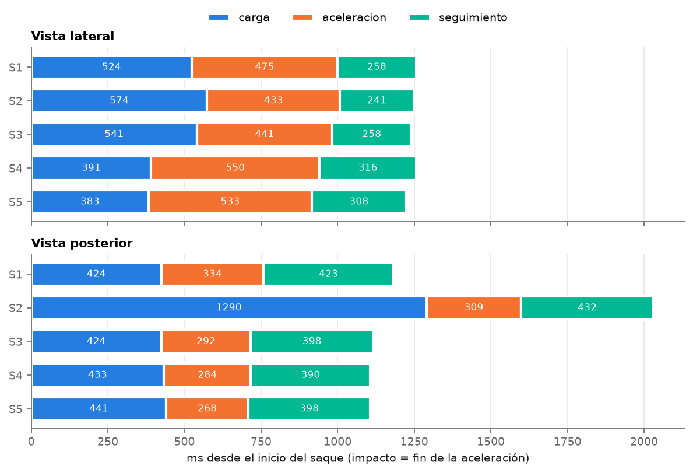

Pico de |ω| de cada segmento (o rapidez de la muñeca) entre el inicio y 50 ms después del impacto.
Los huecos se ignoran, y una serie con menos del 50 % de muestras válidas se omite.

| Saque | Orden observado | τ |
|---|---|---|
| 1 | tronco > codo > brazo > muñeca > muslo | 0.00 |
| 2 | muslo = tronco > brazo = codo > muñeca | 0.89 |
| 3 | muslo > tronco > brazo = codo = muñeca | 0.84 |
| 4 | brazo = codo > muslo > muñeca > tronco | −0.11 |
| 5 | tronco > muslo > codo > brazo > muñeca | 0.60 |

- Los saques 2 y 3 siguen el orden próximo-distal. En el 1 y el 4 el pico del muslo o del tronco cae
  en el borde de la ventana o después del impacto, que es la parte con más huecos.
- El brazo y el codo suelen alcanzar su pico en el mismo fotograma. En 2D no se pueden separar bien.
- Corrección del 26-nov-2026: antes la tabla imprimía el orden *esperado* en lugar del observado, y
  `argmax` sobre series con huecos tomaba el primer NaN como pico.

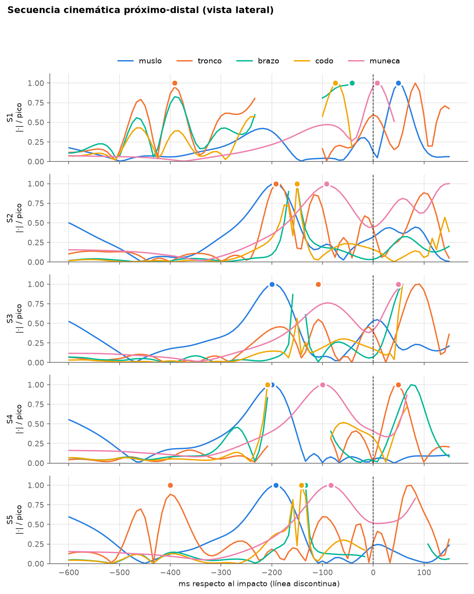

### θ, ω y α por articulación, consistencia y asociaciones

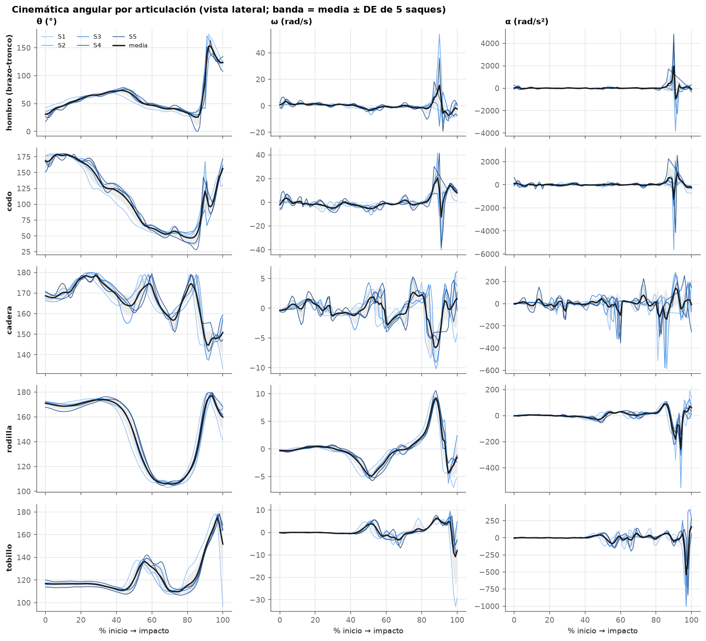

- Picos de |ω| entre el inicio y el impacto (media ± DE): codo 38 ± 19 rad/s, hombro 31 ± 18,
  tobillo 14 ± 11, rodilla 9.6 ± 0.6 y cadera 9.3 ± 2.2. Rodilla y cadera son muy repetibles; los
  picos del brazo dependen del QC cerca del impacto (ver `reports/tables/picos_articulares.csv`).
- **Consistencia:** la variabilidad entre saques sube en el armado del codo (20–50 %) y justo antes del
  impacto (85–95 %). El **saque 1** es el más distinto de la media en casi todas las articulaciones.
- **Asociaciones (Spearman, n = 5, descriptivo):**
  - Más elevación del CoM se asocia con más altura de contacto y de muñeca (ρ = 0.9).
  - Una fase de aceleración más larga se asocia con una carga más corta y menos elevación (ρ = −0.9).
  - Con 5 saques ninguna de estas asociaciones es concluyente.

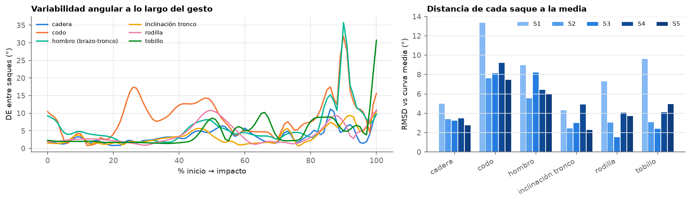
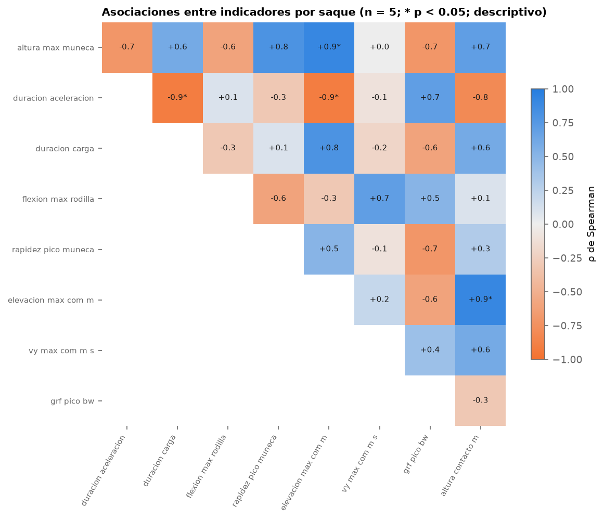

### Jacobiano, filtrado y control de calidad

- **Jacobiano:** J(θ)ω reproduce la rapidez directa de la muñeca con r mediana de 0.87 y un RMSE de
  ~11 % del pico. Las mayores discrepancias están cerca del impacto.
- **Filtrado:** la fc de Winter va de 5 a 9.7 Hz (mediana 8.8 Hz).
- **Control de calidad (lateral):** se anularon ~22 % de las muestras por saltos de tracking, ~16 %
  por rapidez imposible y ~16 % por longitud de segmento.
- **Control de calidad (posterior):** ~25 % por longitud de segmento, ~17 % por saltos de tracking y
  ~6 % por rapidez imposible.
- Los porcentajes se suman sobre marcadores y segmentos, en % de los fotogramas del video.

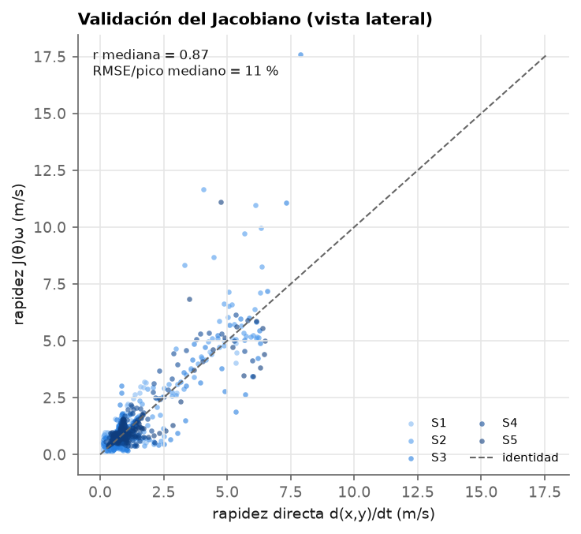
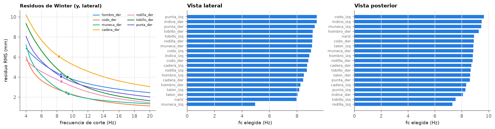
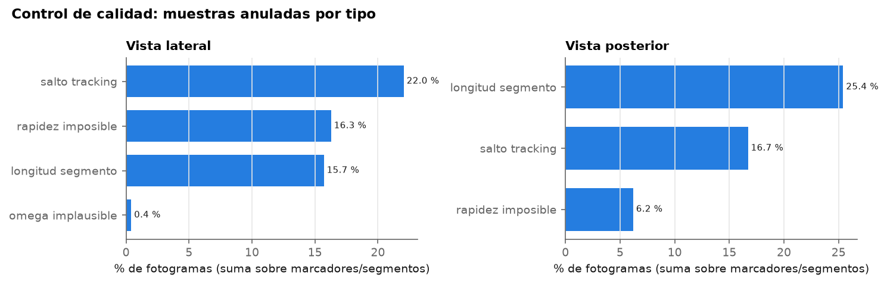

### Centro de masa, salto y fuerza del suelo estimada

El centro de masa (CoM) se estima con las fracciones segmentarias de Winter. La fuerza vertical del
suelo se estima como **F = m·(a_CoM + g)**, sin plataforma de fuerza. Como control, de pie da
1.00–1.02 veces el peso en ambas vistas.

| Saque (lateral) | Altura de contacto (m) | Elevación máx. CoM (m) | v vertical máx. CoM (m/s) | Pico de fuerza (× peso) | Impulso neto (N·s) | Avance del CoM (m) |
|---|---|---|---|---|---|---|
| 1 | 2.09 | 0.16 | 1.23 | 2.1 | 76 | 0.25 |
| 2 | 2.14 | 0.16 | 1.91 | 2.7 | 123 | 0.32 |
| 3 | 2.18 | 0.18 | 1.95 | 2.9 | 127 | 0.35 |
| 4 | 2.09 | 0.14 | 1.87 | 3.6 | 128 | 0.54 |
| 5 | 2.13 | 0.15 | 2.01 | 3.3 | 133 | 0.46 |

- **Altura de contacto:** posición de la pelota en el impacto (≈ 1.3 veces la estatura).
- **Base de apoyo:** los tobillos pasan de estar separados unos 0.46 m al inicio a quedar juntos
  (0.01–0.03 m) en la carga. Es la postura de pies juntos típica del saque.
- **Vista posterior (control):** la elevación del CoM da 0.21 m. La diferencia con la lateral viene
  de la escala y la perspectiva de cada vista.
- **Tiempo de vuelo:** no se reporta, porque con marcadores 2D la altura de los pies no es confiable.
- **Fuerza cerca del impacto:** tampoco es confiable, porque el brazo de golpeo tiene huecos y una
  aceleración muy alta. Solo se interpreta el impulso de piernas.

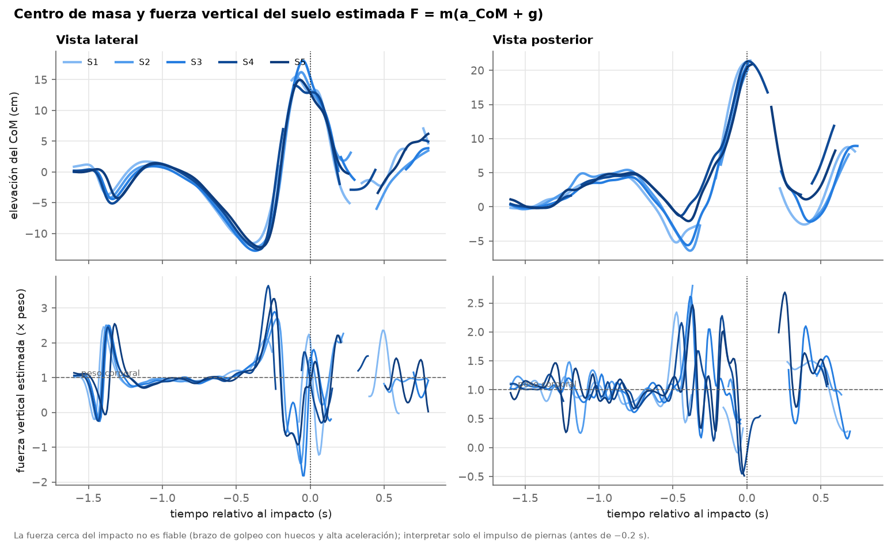
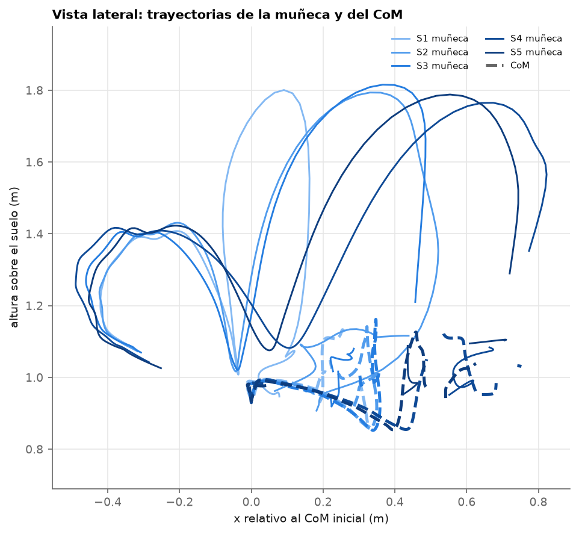

### Ángulos por evento y rango de movimiento

Media de los 5 saques, en grados.

| Vista lateral | Inicio | Máx. flexión de rodilla | Impacto |
|---|---|---|---|
| Rodilla | 171 | 105 | 160 |
| Cadera | 169 | 161 | 151 |
| Codo | 168 | 54 | 163 |
| Hombro (brazo-tronco) | 31 | 41 | 123 |
| Tobillo | 117 | 116 | 152 |
| Inclinación del tronco (0 = vertical) | −19 | 18 | 25 |

| Vista posterior (plano frontal) | Inicio | Máx. flexión de rodilla | Impacto |
|---|---|---|---|
| Inclinación de la línea de hombros | 15 | −37 | 59 |
| Inclinación de la línea de caderas | −20 | −30 | −13 |
| Hombros − caderas | 34 | −7 | 67 |
| Inclinación lateral del tronco | 4 | −25 | 28 |

La línea de hombros pasa de −37° en la carga a +59° en el impacto: es el movimiento de "hombro
sobre hombro" del saque.

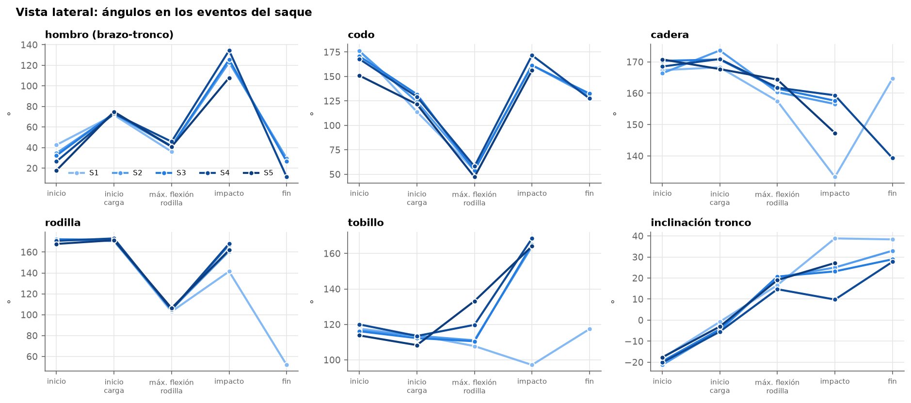
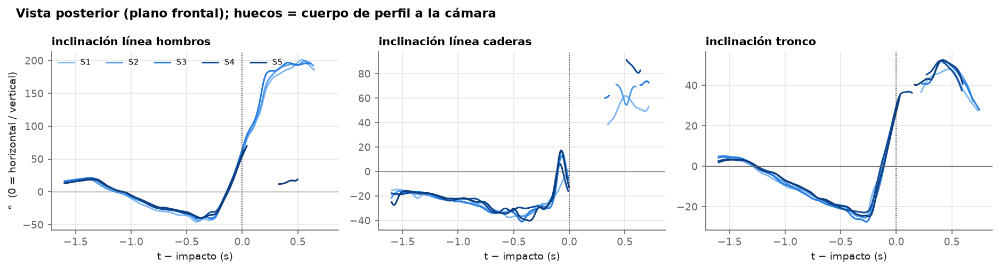
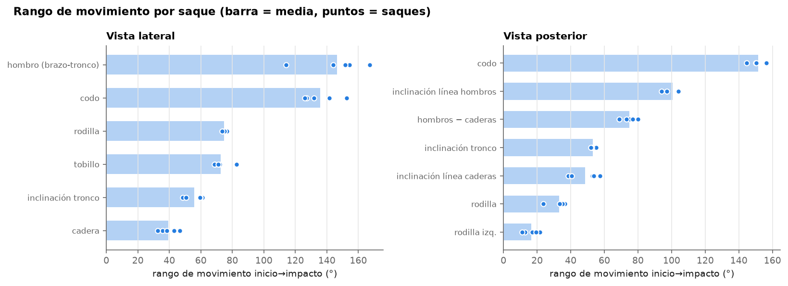

### Palancas y dinámica inversa (exploratorio)

En la máxima flexión de rodilla, la línea del peso pasa unos **0.19–0.21 m detrás de las rodillas**.
Eso da un momento estático del peso de unos 110–120 N·m sobre cada rodilla, que los extensores deben
contrarrestar.

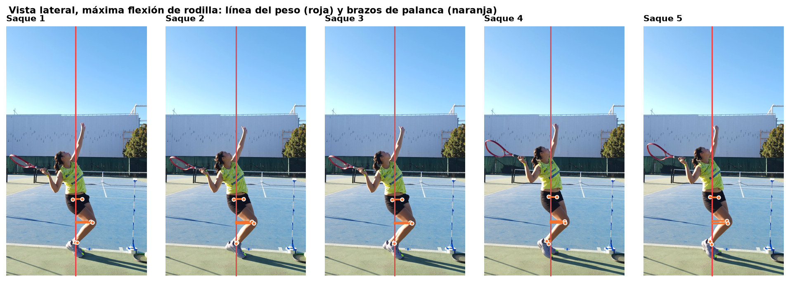

Medianas de los picos de dinámica inversa:

| | Momento | Potencia |
|---|---|---|
| Hombro | 39 N·m | 2066 W |
| Codo | 4 N·m | 91 W |
| Cadera | 116 N·m (96–185) | 497 W (358–1603) |
| Rodilla | 159 N·m (120–198) ≈ 2.7 N·m/kg | 784 W (551–1482) |
| Tobillo | 29 N·m | 99 W |

**Tren inferior con GRF estimada.** No hay plataforma de fuerza, así que la fuerza del suelo se estima
con el centro de masa como F = m·(a_CoM + g), en horizontal y vertical.
- Supuestos: 50 % de la fuerza en cada pierna, porque en la carga los pies quedan juntos, y centro de
  presión a mitad del pie.
- Los picos se buscan entre el inicio de la flexión de rodilla y el despegue.
- El pico de rodilla cae entre 225 y 290 ms antes del impacto, en el empuje.
- La potencia de cadera sale *negativa* en el empuje: el tronco rota hacia atrás (el arco del saque
  kick) contra un momento flexor estimado. Puede ser control excéntrico real, pero depende del centro
  de presión supuesto.
- Antes se usaba GRF = 0 y los momentos de cadera y rodilla salían en 86 y 20 N·m; no representaban
  el apoyo.

Todo es exploratorio. Sin plataforma, el reparto entre pies y el centro de presión son supuestos; el
tren superior no incluye la raqueta, y los picos del hombro están inflados por la doble derivada del
brazo de golpeo.

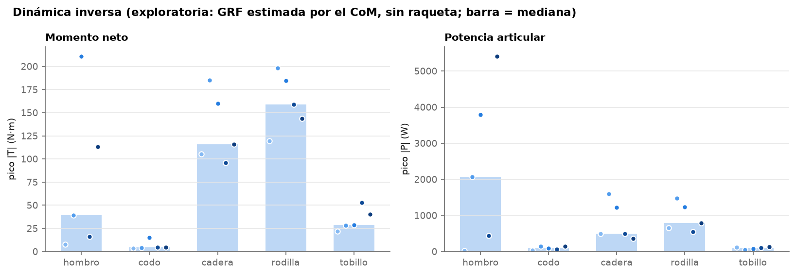

### Indicadores de posible fatiga

| Variable | Confianza | Cambio saque 1 → 5 | ρ Spearman | p (pendiente) |
|---|---|---|---|---|
| Duración de la carga | alta | −27 % | −0.7 | 0.09 |
| Duración de la aceleración | alta | +12 % | +0.6 | 0.19 |
| Flexión máx. de rodilla | alta | +3 % (menos flexión) | +0.7 | 0.07 |
| Altura máx. de muñeca | alta | −0.7 % | −0.6 | 0.44 |
| Rapidez pico de muñeca | media | −43 %\* | −0.5 | 0.18 |
| ω pico de codo (n = 3) | baja | −7 % | −0.5 | 0.97 |

**Lectura:** en los saques 4 y 5 la fase de carga se acorta (~390 ms frente a ~545 ms) y la rodilla se
flexiona un poco menos. Ese patrón es compatible con un menor uso de las piernas al final de la serie,
pero ningún indicador alcanza p < 0.05 y con 5 saques la evidencia de fatiga **no es concluyente**.
Para confirmarlo harían falta series más largas, de unos 20–30 saques.


## Limitaciones

Cinemática 2D por vista (proyecciones), un solo sujeto, impacto fechado con la pelota pero sin medir su
velocidad, dinámica inversa con supuestos fuertes (GRF estimada por el CoM, muñeca libre). Ver
[`docs/pipeline_saque_kick.md`](docs/pipeline_saque_kick.md) §8.
