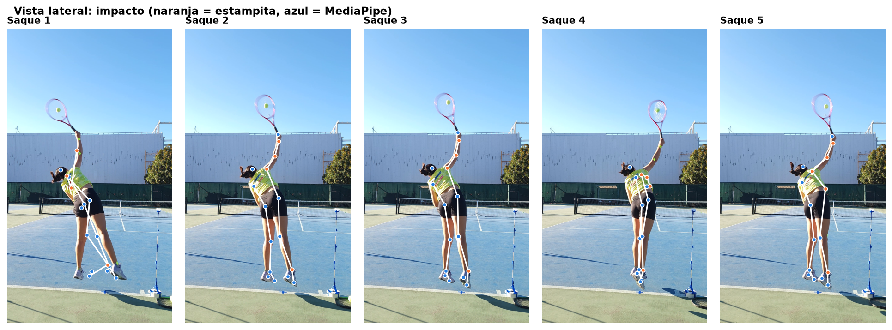
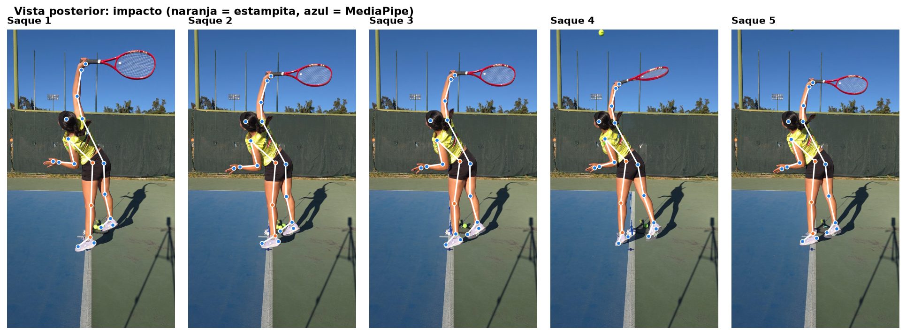
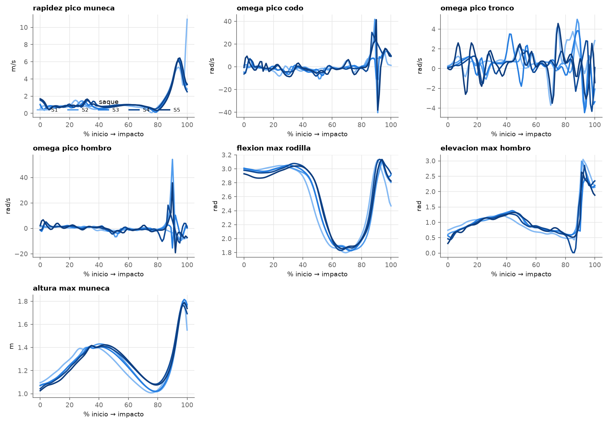
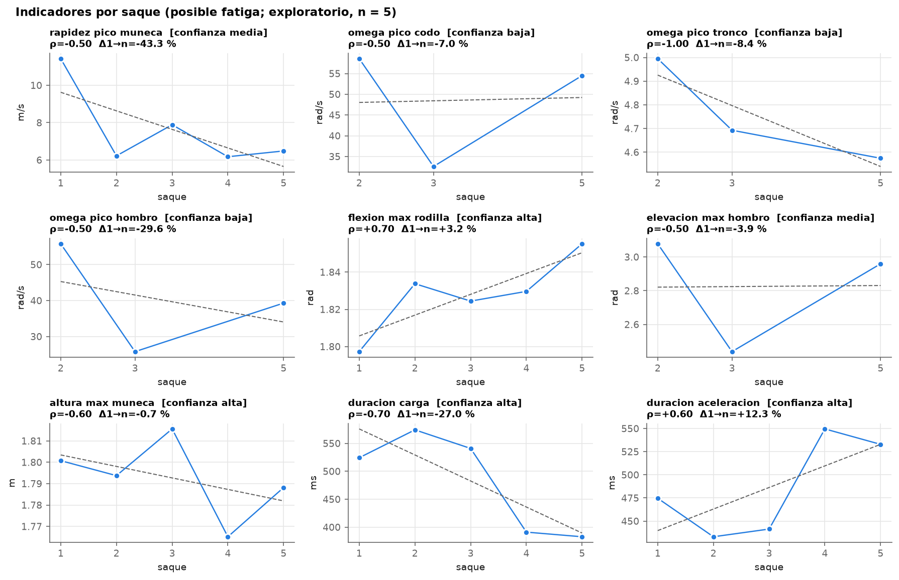

# Análisis cinemático 2D del saque kick (`saque`)

Pipeline en Python que analiza **los videos completos** de una jugadora del equipo representativo del
Tec (vistas lateral y posterior, 120 fps) con **MediaPipe Pose** + **seguimiento de las estampitas**
adheridas a las articulaciones. Detecta automáticamente los 5 saques, calcula θ/ω/α articulares,
fases, secuencia próximo-distal, velocidad de la mano con el Jacobiano, dinámica inversa exploratoria
y **indicadores de posible fatiga a lo largo de la serie**.

Sustituye al flujo anterior basado en exportaciones manuales de Kinovea de un solo saque
(los CSV se conservan en `data/raw/kinovea/` como referencia histórica; el pipeline ya no los usa).

## Uso rápido

```bash
python -m venv .env && source .env/bin/activate
pip install -e ".[dev]"          # requiere ffmpeg/ffprobe en el PATH

saque run                        # pipeline completo (MediaPipe ~5 min por video; queda en caché)
saque run --stages kinematics serves analysis report    # sin repetir MediaPipe
saque calibrate lateral          # fotograma con rejilla para medir la vara de 1 m
pytest                           # 41 pruebas con datos sintéticos (sin video)
```

Sin instalar: `python scripts/run_pipeline.py [--stages ...]`.

Los videos van en `data/raw/video/lateral.mp4` y `data/raw/video/posterior.mp4` (ignorados por git:
pesan >100 MB). El modelo `pose_landmarker_heavy.task` se descarga solo a `models/`.

> **MediaPipe:** se fija `mediapipe>=0.10.30,<1.0`. Las versiones 1.x se cierran al cargar el modelo
> (probado en Python 3.11 y 3.14); 0.10.35 funciona en Python 3.14.

## Estructura

```
config/pipeline.yaml       toda la configuración (sujeto, vistas, calibración, estampitas, QC, fatiga)
data/raw/video/            videos originales (solo lectura)
data/raw/kinovea/          exportaciones antiguas de Kinovea (histórico, no se usan)
data/interim/pose/         pose por fotograma de MediaPipe + estampitas (caché .parquet)
data/processed/<vista>/    marcadores (px y m), cinemática y una carpeta por saque
reports/                   report.md, tables/*.csv, figures/*.png
src/saque/
  video/       reader (ffmpeg), pose (MediaPipe), stickers, ball (fecha el impacto), extract
  processing/  markers (fusión + calibración + QC geométrico), qc, filtering, kinematics
  analysis/    serves, events, jacobian, inverse_dynamics, levers, stats, fatigue
  reporting/   viz, report
  pipeline.py  etapas: pose → kinematics → serves → analysis → report
  cli.py       comando `saque`
tests/         pruebas unitarias y de punta a punta con datos sintéticos
docs/          contexto del proyecto y documento maestro del pipeline
```

## Qué hace cada etapa

| Etapa | Qué hace |
|---|---|
| `pose` | MediaPipe en cada fotograma; busca la estampita alrededor de cada landmark configurado. Usa el **tiempo real** de cada fotograma (pts): los celulares pierden fotogramas. |
| `kinematics` | Fusiona estampita/landmark, calibra con la vara (m, y hacia arriba), QC (saltos, longitudes de segmento, rapidez imposible), Butterworth con corte de Winter por tramos, θ/ω/α y velocidades. |
| `serves` | Candidatos por altura de muñeca; **impacto = fin de la caída de la pelota** (vista lateral); la vista posterior se sincroniza por correlación de la altura de cadera. |
| `analysis` | Por saque: eventos, fases, secuencia, Jacobiano, dinámica inversa. Entre saques: fatiga y variabilidad. |
| `report` | Figuras y `reports/report.md`. |

Detalle de métodos, decisiones y limitaciones: [`docs/pipeline_saque_kick.md`](docs/pipeline_saque_kick.md).

## Resultados (corrida del 26-nov-2026)

> Una jugadora, 5 saques, cinemática 2D. Todo lo que compara saques es **exploratorio**.
> Las figuras de esta sección son copias de `reports/figures/` guardadas en `docs/img/`.
> Para actualizarlas después de correr el pipeline: `cp reports/figures/*.png docs/img/`.

### Detección de saques e impacto

Se detectan automáticamente los 5 saques en las dos vistas. El impacto se fecha con el fin de la caída
de la pelota, y en los 5 casos el fotograma marcado muestra la pelota en las cuerdas.

| Métrica | Valor |
|---|---|
| Saques detectados | 5 / 5 (impactos a los 5.0, 13.1, 22.8, 31.2 y 41.2 s del video lateral) |
| Desfase entre vistas | posterior = lateral + 0.64 s (correlación de cadera 0.75) |
| Fotogramas perdidos | 24 (lateral) y 15 (posterior), corregidos con el tiempo real de cada fotograma |
| Estatura aparente (control de escala) | 1.58 m (lateral), 1.59 m (posterior); real 1.64 m |




### Seguimiento de las estampitas

Porcentaje de fotogramas en que la posición del marcador viene de la estampita (el resto usa
MediaPipe corregido o queda como hueco):

| Vista lateral | Hombro | Codo | Muñeca | Cadera | Rodilla | Tobillo | Punta |
|---|---|---|---|---|---|---|---|
| % estampita | 96 | 71 | 80 | 63 | 74 | 72 | 69 |

En la vista posterior: cadera izq. 91 %, rodilla izq. 86 %, tobillos 64 % y 51 %.

### Cinemática por saque (vista lateral)

| Saque | Carga (ms) | Aceleración (ms) | Flexión máx. rodilla (°) | Altura máx. muñeca (m) | Rapidez pico muñeca (m/s) | ω pico codo (rad/s) | τ secuencia |
|---|---|---|---|---|---|---|---|
| 1 | 524 | 475 | 103 | 1.80 | 11.4\* | —† | 0.00 |
| 2 | 574 | 433 | 105 | 1.79 | 6.2 | 58.6 | 0.95 |
| 3 | 541 | 441 | 104 | 1.82 | 7.9 | 32.6 | 0.74 |
| 4 | 391 | 550 | 105 | 1.77 | 6.2 | —† | 0.63 |
| 5 | 383 | 533 | 107 | 1.79 | 6.5 | 54.5 | 0.60 |

- Flexión de rodilla: ángulo interior mínimo (180° = pierna extendida).
- τ de secuencia: τ de Kendall del orden muslo → tronco → brazo → codo → muñeca (1 = orden próximo-distal perfecto).
- \* Probable artefacto: en ese saque el brazo de golpeo se pierde cerca del impacto.
- † Excluido porque menos del 80 % de las muestras son válidas en los 200 ms previos al impacto.



### Indicadores de posible fatiga

| Variable | Confianza | Cambio saque 1 → 5 | ρ Spearman | p (pendiente) |
|---|---|---|---|---|
| Duración de la carga | alta | −27 % | −0.7 | 0.09 |
| Duración de la aceleración | alta | +12 % | +0.6 | 0.19 |
| Flexión máx. de rodilla | alta | +3 % (menos flexión) | +0.7 | 0.07 |
| Altura máx. de muñeca | alta | −0.7 % | −0.6 | 0.44 |
| Rapidez pico de muñeca | media | −43 %\* | −0.5 | 0.18 |
| ω pico de codo (n = 3) | baja | −7 % | −0.5 | 0.97 |

**Lectura:** en los saques 4 y 5 la fase de carga se acorta (~390 ms frente a ~545 ms) y la rodilla se
flexiona un poco menos. Ese patrón es compatible con un menor uso de las piernas al final de la serie,
pero ningún indicador alcanza p < 0.05 y con 5 saques la evidencia de fatiga **no es concluyente**.
Para confirmarlo harían falta series más largas, de unos 20–30 saques.



## Limitaciones

Cinemática 2D por vista (proyecciones), un solo sujeto, impacto fechado con la pelota pero sin medir su
velocidad, dinámica inversa con supuestos fuertes (GRF = 0, muñeca libre). Ver
[`docs/pipeline_saque_kick.md`](docs/pipeline_saque_kick.md) §8.
